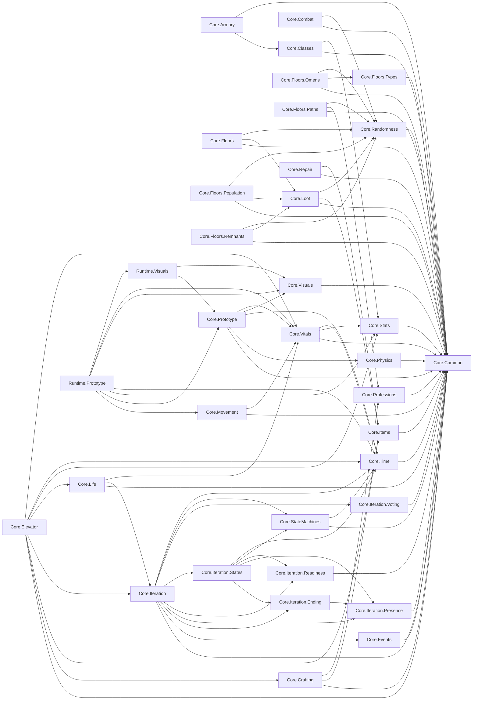

<!-- GENERADO por `python3 -m tools.arch`; no editar a mano. -->

# Índice de módulos (C4 nivel 3: componentes)

Un módulo = un namespace C#. Abre solo la página del módulo que vayas a tocar.

| Módulo | Ficheros | Tipos principales | Depende de |
|---|---|---|---|
| [Core.Armory](modulos/Core.Armory.md) | 3 | `ArmoryStock`, `ClassKitArmory`, `IArmoryStock` | Core.Classes, Core.Common |
| [Core.Classes](modulos/Core.Classes.md) | 8 | `ClassKit`, `ClassKitCatalog`, `ClassKitId`, `ClassResourceType`, `ClassRole` … | Core.Common, Core.Stats |
| [Core.Combat](modulos/Core.Combat.md) | 8 | `ArmorMitigation`, `CritRules`, `DamageCalculator`, `DamageResult`, `DamageType` … | Core.Common, Core.Randomness |
| [Core.Common](modulos/Core.Common.md) | 1 | `Guard` | — |
| [Core.Crafting](modulos/Core.Crafting.md) | 11 | `CraftResult`, `CraftTransaction`, `Crafter`, `IRecipeBook`, `ISynergyRecipeBook` … | Core.Common, Core.Items, Core.Professions |
| [Core.Elevator](modulos/Core.Elevator.md) | 18 | `BlueprintCatalog`, `BonfireConfig`, `BonfireRest`, `BuildResult`, `Bunk` … | Core.Common, Core.Crafting, Core.Items, Core.Iteration, Core.Life, Core.Stats, Core.Time, Core.Vitals |
| [Core.Events](modulos/Core.Events.md) | 2 | `EventBus`, `IEventPublisher`, `IEventSubscriber`, `IEventBus` | Core.Common |
| [Core.Floors](modulos/Core.Floors.md) | 8 | `Corridor`, `FloorConnectivity`, `FloorLayout`, `FloorRoom`, `IFloorGenerator` … | Core.Common, Core.Loot, Core.Randomness |
| [Core.Floors.Omens](modulos/Core.Floors.Omens.md) | 5 | `FloorModifier`, `FloorModifierCatalog`, `FloorModifierKind`, `Omen`, `OmenRoller` | Core.Common, Core.Floors.Types, Core.Randomness |
| [Core.Floors.Paths](modulos/Core.Floors.Paths.md) | 4 | `AlternativePathPlanner`, `FloorPaths`, `SealMethod`, `SealedDoorRules` | Core.Common, Core.Professions, Core.Randomness |
| [Core.Floors.Population](modulos/Core.Floors.Population.md) | 5 | `FloorPopulation`, `FloorPopulator`, `RingPopulationRules`, `RingQuota`, `RoomPopulation` | Core.Common, Core.Loot, Core.Randomness |
| [Core.Floors.Remnants](modulos/Core.Floors.Remnants.md) | 8 | `FloorRemnants`, `FragmentPlacement`, `MemoryFragmentLog`, `Remnant`, `RemnantKind` … | Core.Common, Core.Loot, Core.Randomness |
| [Core.Floors.Types](modulos/Core.Floors.Types.md) | 9 | `PuzzleFloor`, `DecisionFloor`, `SanctuaryFloor`, `ProfessionFloor`, `LootFloor` … | Core.Common |
| [Core.Items](modulos/Core.Items.md) | 11 | `Durability`, `IDurability`, `IInventory`, `Inventory`, `ItemCategory` … | Core.Common |
| [Core.Iteration](modulos/Core.Iteration.md) | 9 | `IterationConfig`, `IterationConfigBuilder`, `IterationContext`, `IterationPhaseChanged`, `FloorReached` … | Core.Common, Core.Events, Core.Iteration.Ending, Core.Iteration.Presence, Core.Iteration.Readiness, Core.Iteration.States, Core.Iteration.Voting, Core.StateMachines, Core.Time |
| [Core.Iteration.Ending](modulos/Core.Iteration.Ending.md) | 3 | `FateResolver`, `IterationEnded`, `IterationOutcome`, `PlayerFate` | Core.Iteration.Presence |
| [Core.Iteration.Presence](modulos/Core.Iteration.Presence.md) | 4 | `PlayerLocation`, `PlayersTrapped`, `PlayerRescued`, `PresenceTracker`, `TrappedModifiers` | Core.Common |
| [Core.Iteration.Readiness](modulos/Core.Iteration.Readiness.md) | 4 | `HasteBonusEarned`, `IHasteBonusPolicy`, `LinearHasteBonus`, `ReadyCheck` | Core.Common |
| [Core.Iteration.States](modulos/Core.Iteration.States.md) | 5 | `CalmState`, `EndedState`, `IncursionState`, `SignalState`, `TimedPhaseState` | Core.Iteration.Ending, Core.Iteration.Presence, Core.Iteration.Readiness, Core.StateMachines, Core.Time |
| [Core.Iteration.Voting](modulos/Core.Iteration.Voting.md) | 2 | `EarlyCloseVote`, `EarlyCloseApproved`, `MajorityVote` | Core.Common |
| [Core.Life](modulos/Core.Life.md) | 7 | `CharacterLife`, `IReviveCost`, `LifeState`, `PartyLife`, `ReviveMethod` … | Core.Common, Core.Iteration, Core.Vitals |
| [Core.Loot](modulos/Core.Loot.md) | 6 | `DepthRings`, `IRingWeighting`, `LootDrop`, `LootEntry`, `LootTable` … | Core.Common, Core.Items, Core.Randomness |
| [Core.Movement](modulos/Core.Movement.md) | 6 | `CameraPoint`, `MovementConfig`, `PlanarMover`, `PlanarVector`, `SprintController` … | Core.Common, Core.Vitals |
| [Core.Physics](modulos/Core.Physics.md) | 4 | `ColliderBox`, `CollisionLayer`, `CollisionMatrix`, `DefaultCollisionMatrix` | Core.Common |
| [Core.Professions](modulos/Core.Professions.md) | 6 | `DefaultProfessionSynergies`, `ISynergyCatalog`, `ProfessionBench`, `ProfessionId`, `ProfessionSynergy` … | Core.Common |
| [Core.Prototype](modulos/Core.Prototype.md) | 7 | `DebugCommands`, `DebugHudPresenter`, `GreyboxRoomLayout`, `HudTime`, `ILevelLayout` … | Core.Common, Core.Physics, Core.Time, Core.Visuals, Core.Vitals |
| [Core.Randomness](modulos/Core.Randomness.md) | 2 | `IRandom`, `Pcg32Random` | Core.Common |
| [Core.Repair](modulos/Core.Repair.md) | 6 | `IRepairCatalog`, `RepairCatalog`, `RepairReport`, `RepairResult`, `RepairRule` … | Core.Common, Core.Items |
| [Core.StateMachines](modulos/Core.StateMachines.md) | 3 | `IState`, `StateBase`, `StateMachine`, `Transition` | Core.Common, Core.Time |
| [Core.Stats](modulos/Core.Stats.md) | 7 | `IStatFormula`, `ModifierKind`, `StandardStatFormula`, `Stat`, `StatModifier` … | Core.Common |
| [Core.Time](modulos/Core.Time.md) | 4 | `IClock`, `ITickable`, `ManualClock`, `PhaseTimer` | Core.Common |
| [Core.Visuals](modulos/Core.Visuals.md) | 14 | `DefaultGreyboxStyles`, `GreyboxColor`, `GreyboxOffset`, `GreyboxPrimitive`, `GreyboxStyle` … | Core.Common |
| [Core.Vitals](modulos/Core.Vitals.md) | 6 | `CharacterVitals`, `Fatigue`, `FatigueConfig`, `ResourceKind`, `ResourcePool` … | Core.Common, Core.Stats, Core.Time |
| [Runtime.Prototype](modulos/Runtime.Prototype.md) | 7 | `DebugHud`, `PlayerMotor`, `PrototypeBootstrap`, `PrototypeInput`, `PrototypePlayer` … | Core.Movement, Core.Prototype, Core.Stats, Core.Time, Core.Visuals, Core.Vitals, Runtime.Visuals |
| [Runtime.Visuals](modulos/Runtime.Visuals.md) | 3 | `CatalogoVisual`, `GreyboxFactory`, `VisualSpawner` | Core.Prototype, Core.Visuals |

## Grafo de dependencias (flecha = «usa a»)

