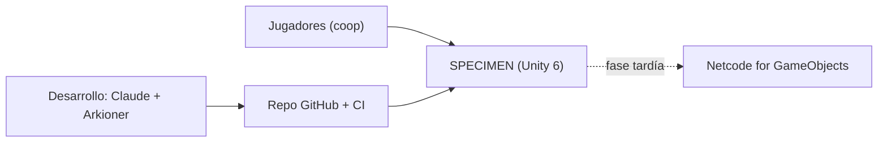

# Arquitectura de SPECIMEN (modelo C4)

Mapa para **no leer el repo entero**: elige el nivel que necesitas y baja solo hasta la página del módulo que vas a tocar.

| Nivel | Qué responde | Dónde |
|---|---|---|
| 1 Contexto | Quién usa el sistema y con qué se relaciona | este fichero |
| 2 Contenedores | Ensamblados, proyectos y herramientas | este fichero |
| 3 Componentes | Módulos (namespaces), tipos y dependencias | [MODULOS.md](MODULOS.md) (generado) |
| 4 Código | Un fichero concreto | `modulos/<Módulo>.md` indica carpeta, tests y qué hace cada fichero |

## Nivel 1 · Contexto



## Nivel 2 · Contenedores

```mermaid
flowchart TB
  subgraph Unity["Proyecto Unity (Assets/_Project)"]
    RT["Specimen.Runtime<br/>MonoBehaviours, input, escenas"]
    CORE["Specimen.Core<br/>C# puro, sin UnityEngine"]
    TEST["Specimen.Tests.EditMode<br/>NUnit"]
  end
  DN["dotnet/Specimen.Core(.Tests)<br/>mismas fuentes, sin Unity"]
  TOOLS["tools/<br/>progress, session, arch, tests"]
  DOCS["docs/<br/>GDD, backlog, sesiones, arquitectura"]
  RT --> CORE
  TEST --> CORE
  DN -. compila .-> CORE
  TOOLS -. valida y genera .-> DOCS
  TOOLS -. verify.sh .-> DN
```

| Contenedor | Ruta | Regla |
|---|---|---|
| Núcleo | `Assets/_Project/Scripts/Core` | Sin `UnityEngine`; la lógica de juego vive aquí |
| Runtime | `Assets/_Project/Scripts/Runtime` | Capa fina que adapta Unity al núcleo; depende de Core, nunca al revés |
| Tests Unity | `Assets/_Project/Tests/EditMode/Core` | Espejo de las carpetas de Core |
| Núcleo sin Unity | `dotnet/` | `tools/verify.sh` compila (warnings = error) y ejecuta NUnit |
| Herramientas | `tools/` | Python; `tools/tests` impone las reglas del repo |

## Flujo para ahorrar tokens

1. `python3 -m tools.progress --next` → tarea y página de fase.
2. Abre [MODULOS.md](MODULOS.md), localiza el módulo y lee solo `modulos/<Módulo>.md`.
3. Lee los ficheros de ese módulo (y los de «Depende de» únicamente si cambias su contrato).
4. Tras añadir, mover o renombrar tipos: `python3 -m tools.arch` (CI falla si el índice está obsoleto).

Convención: la primera frase del `/// <summary>` de cada tipo alimenta el índice; escríbela con intención.
